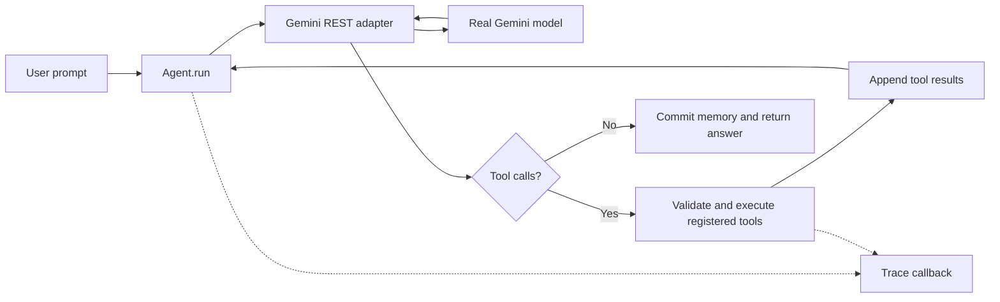

# Architecture and design choices

The framework separates decisions, execution, and transport. Gemini chooses which tool to call; the framework validates and executes registered functions; the Gemini adapter handles the wire format. Inventory-specific logic exists only in the example.

## Small public API

- `tool({ name, description, parameters, execute })` produces a callable tool with a schema and validator.
- `new Agent({ model, instructions, tools, maxSteps, maxToolCalls, onEvent })` creates one independent conversation.
- `agent.run(prompt)` returns `{ text, steps, toolCalls, trace }`; model/network/limit failures throw.
- `agent.messages` returns a defensive copy; `agent.reset()` clears all but the instructions.
- `new Gemini({ apiKey, model, timeoutMs })` implements `chat({ messages, tools })` using built-in `fetch`.

Another model adapter can implement the same `chat` contract, returning an assistant message with `content` and optional `tool_calls`. Each call has `function: { name, arguments }` and an optional `id`. This small interface also allows deterministic tests. Gemini-specific opaque parts are retained in `providerParts` so the adapter can round-trip thought signatures without interpreting them. Function response IDs are preserved, and multiple results from one model turn are grouped in a single Gemini message. The implementation follows [Google's function-calling documentation](https://aistudio.google.com/docs/function-calling?generate-content=true).

## Why these choices

**Explicit tool schemas.** JavaScript functions do not retain argument types. A short schema is easier to review than parsing source code, introducing decorators, or adding a schema library. The subset is intentionally limited to required primitive parameters. The framework checks structural types; handlers enforce business rules.

**A sequential loop.** Tools run in response order, even if the model emits several calls. This keeps state and traces easy to inspect. Separate model-step and tool-call budgets prevent one large batch from bypassing the run limit. A batch exceeding the remaining budget is rejected before any tool in that batch executes. These are iteration limits, not a total wall-clock deadline.

**Structured errors as feedback.** Tool errors become `{ ok: false, error }` results, giving the model a chance to repair arguments within the remaining budget. Transport errors stop the run: retrying invisibly would obscure quotas and make the demo less predictable. Handler error text is sent to the model, so tool authors should use messages appropriate for that audience.

**Transactional conversation history.** Each run works on a copy and commits only when it receives a nonempty final answer. A failed turn therefore does not leave incomplete tool messages in the next request. This does not undo external tool side effects. The example only reads data and calculates quotes. One instance allows one active run; use separate instances for separate conversations.

**Trace events instead of a logging system.** Events expose the executed path without requesting or printing the model's private reasoning. The CLI prints them; another application can route them elsewhere. Observer exceptions are ignored so a broken logger cannot fail the agent. Failed runs are observable through `onEvent`; successful runs also return a trace.

**Deterministic business logic.** Prices use integer cents, and the quote handler computes totals and stock availability. The model supplies intent and language. It cannot place orders because no such tool exists. Natural-language answers can still be wrong; the live check verifies the underlying tool results, and the recording should also inspect the displayed answer.

## Deliberate limits

No persisted memory, summarization, retrieval database, multi-agent orchestration, streaming, automatic retries, UI, deployment, or CI. Conversation history grows until reset. Tool execution is trusted and has no sandbox or timeout; a hanging handler can hang a run. Only the HTTP request has a timeout. Output size is not bounded for arbitrary tool handlers, and argument schemas do not support nested objects, optional values, or enums. These limits keep the proof of concept small and reviewable.

The default Gemini model is configurable; account quotas and model availability remain external dependencies. No SDK is required because the demo uses a narrow REST surface.
